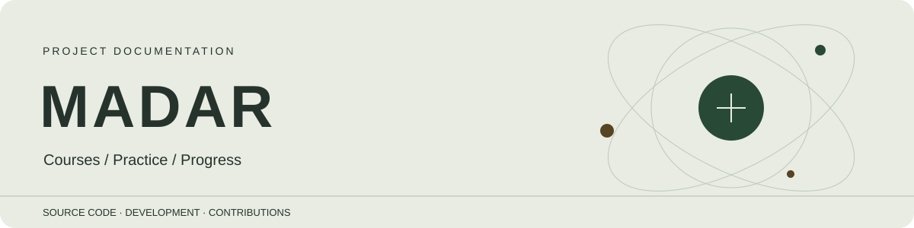

<p align="center">
  
</p>

# MADAR

An Arabic-language learning application for course material, revision, and practice, with account features, progress storage, notes, and backup workflows.

This repository contains the application source and its resources. The documentation provides a starting point for first-time visitors and direct references for developers.

<p align="center">
  <a href="docs/START_HERE.md">Start here</a> ·
  <a href="docs/STORY.md">The story</a> ·
  <a href="docs/HISTORY.md">History</a> ·
  <a href="docs/ENGINEERING.md">For developers</a> ·
  <a href="docs/DEVELOPMENT.md">Development</a> ·
  <a href="https://dahman0al0shahri.github.io/madar/">Interactive code atlas</a> ·
  <a href="docs/ARCHITECTURE.md">Architecture</a> ·
  <a href="CONTRIBUTING.md">Maintenance policy</a> ·
  <a href="CHANGELOG.md">Changelog</a> ·
  <a href="docs/README.md">Documentation</a>
</p>

MADAR is experimental. Anyone can view, download or fork the source. The owner restricts pull requests to authorized collaborators. See the [maintenance policy](CONTRIBUTING.md), [merged changes](https://github.com/dahman0al0shahri/madar/pulls?q=is%3Apr+is%3Amerged) and [project history](docs/HISTORY.md). The [hosted application](https://madar-word-lab.d7d7y7.chatgpt.site) has a separate deployment history. The [repository report](docs/REPOSITORY_REPORT.md) records its last verified version and [hosted verification](docs/HOSTED_VERIFICATION.md) records which account checks have been performed.

Developers can follow [a theory review answer from selection to recovery](docs/ENGINEERING.md#trace-a-theory-review-answer) or [trace the home page build](docs/ENGINEERING.md#edit-the-home-assembly). For the repository controls, source decisions, remaining package advisories and verification boundaries, see the [maintainer handoff](docs/REPOSITORY_REPORT.md#maintainer-handoff). Each current [atlas tour](docs/code-atlas/README.md#feature-verification) links its test and command.

## The Story Behind MADAR

Read [the project owner's story](docs/STORY.md): the current experimental stage, classmates' use, continuous learning inside and outside college, AI-assisted development, and possible future directions.

The repository also documents the owner's work and MADAR's development, with the ambition that this record will support future opportunities and important turning points in the owner's life.

MADAR began on **18 Rabi al-Awwal 1448 AH (31 August 2026, Umm al-Qura)**, as confirmed by its owner. Read [MADAR's history](docs/HISTORY.md) for its development from early Word revision work to multiple courses and the current repository workflow, with the evidence and limits for each milestone.

## Courses and learning workflows

The following courses are registered in the [course registry](lib/course-base.mjs). Registration does not imply equal content coverage or public access to every course.

| Course | Registered content |
| --- | --- |
| Advanced Computer Applications — تطبيقات الحاسب المتقدمة | Word, Excel, and Access |
| Routing and Switching 1 — التوجيه والتحويل ١ | Networking material, revision, and a simulation lab |
| Operating Systems 1 — نظم التشغيل 1 | Operating systems course material |

The code includes progress, notes, review, and feedback workflows. Access depends on the route and account permissions. Practice results are learning records, not independent proof of mastery or unaided performance.

## Find your starting point

| Your goal | Read |
| --- | --- |
| Understand the project without GitHub experience | [Start here](docs/START_HERE.md) |
| Find and test the network lab or OS simulator build | [First-time maintainer trial and walkthrough](docs/ENGINEERING.md#trace-the-simulator-builds) |
| Trace a saved Word lesson note | [Open the interactive tour](https://dahman0al0shahri.github.io/madar/#view=map&feature=lesson-notes) · [Run the note test from a fresh clone](docs/code-atlas/README.md#trace-a-word-lesson-note-from-a-clean-checkout) |
| Trace and test the announcement animation from a fresh clone | [First maintenance task](docs/ENGINEERING.md#trace-the-announcement-animation) |
| Join a maintenance task or review the code | [Engineering guide](docs/ENGINEERING.md) · [Code map](docs/CODE_MAP.md) |
| Set up a local development environment | [Development guide](docs/DEVELOPMENT.md) |
| Find the source of a feature | [Architecture and source map](docs/ARCHITECTURE.md) |
| Understand feedback and owner-controlled changes | [Maintenance policy](CONTRIBUTING.md) |
| Add a course or practice workflow | [Course integration checklist](docs/COURSE_INTEGRATION.md) |
| Keep application changes and GitHub updates aligned | [Maintenance workflow](docs/MAINTENANCE.md) · [Changelog](CHANGELOG.md) |
| Review data handling and included sources | [Security](SECURITY.md) · [Bundled components and sources](docs/RIGHTS.md) |

## Developer quick start

Use **Node.js 22.13.0 or later** and npm. From the repository root:

```sh
npm run install:ci
npm run db:local
npm run dev
```

The default portable development profile uses port **5173**. Open the URL printed by the server. `db:local` applies the existing SQL migrations to this checkout's local database; it does not access hosted data. See the [development guide](docs/DEVELOPMENT.md) for verification evidence and limits.

Local sign-in uses a test identity. Hosted authentication and storage depend on the Sites environment. Uploading the source to GitHub does not deploy the application or provision those services.

To check repository safeguards, generated outputs, local documentation links, hub behavior and simulator tests without installing project dependencies:

```sh
node scripts/check-repository.mjs
```

After installing dependencies, `npm run check:application` builds and tests local startup, persistence and SQL recovery with isolated synthetic data. A separate Chromium suite checks desktop/mobile interactions, account export and six visual references. GitHub runs four jobs: repository checks, Windows application checks, Linux application checks, and Linux browser/visual checks. It does not deploy the application. See [development](docs/DEVELOPMENT.md), [browser checks](docs/BROWSER_TESTS.md), and [backup/recovery](docs/BACKUP_RECOVERY.md).

## Repository map

| Directory | Purpose |
| --- | --- |
| `app/` | Web routes, request handlers, and user identity |
| `modules/` | Sources for generated application modules |
| `lib/` | Application logic, content, and some generated files |
| `public/` | Browser resources, interfaces, and generated assets |
| `drizzle/` | SQL migration history |
| `build/` | Build and hosting integration |
| `scripts/` | Generation, development, and verification commands |
| `tests/` | Repository safeguards, local integration helpers, browser tests and visual references |
| `docs/` | Project guides and historical design records |
| `.github/` | Automated checks and contribution templates |

Identify a generated file's source and generator before changing it. See [architecture](docs/ARCHITECTURE.md) for details.

## Project constraints

- Keep synthetic test data separate from real learner records.
- Changes to the appearance of Advanced Computer Applications require explicit authorization from the project owner, including changes caused by shared assets.
- Course integration includes accounts, persistence, restore, notes, statistics, and feedback—not just a visible course page.
- Local networking tests do not cover every course, hosted authentication, or complete account isolation.

## Publication and included material

The repository is public at the owner's explicit request, with external pull request creation restricted. It includes project work, external libraries and course-source files; existing notices are listed in [bundled components and sources](docs/RIGHTS.md). Public visibility is not a new project-wide license. Keep real learner data, backups and credentials out of commits.

Repository-facing documentation is written in English. The application's Arabic content and original course names retain their source language.

Browser regression checks: [desktop/mobile interactions and visual references](docs/BROWSER_TESTS.md).

Hub scene resources, route lifecycle and course rendering are documented in [hub contracts](docs/HUB_CORE.md). Maintainers should edit their native module or explicit browser adapter; the hub builder uses checked named slots instead of rewriting function bodies. Existing OS/network engines remain compatibility inputs.
